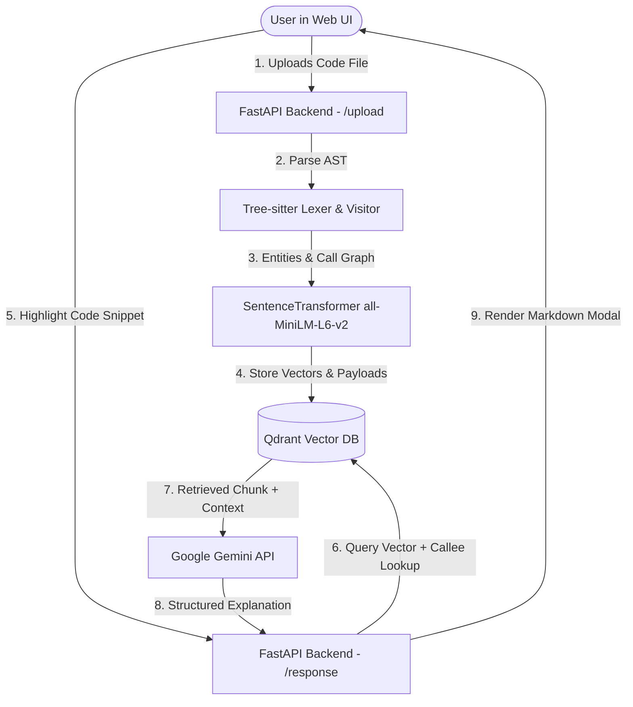

# Xplane

> **Code-Aware Retrieval-Augmented Generation (RAG) & Semantic Code Explainer**  
> Powered by AST parsing (Tree-sitter), dense embeddings (SentenceTransformers), vector search (Qdrant), and LLM reasoning (Google Gemini).

---

## Overview

**RETRIEVR** is a full-stack developer intelligence tool designed to parse, index, search, and explain source code with structural context. 

Traditional RAG tools chunk code naively by line count or token window, breaking function scopes, class boundaries, and context. RETRIEVR leverages **Tree-sitter AST parsing** to extract syntax-aware entities (functions, classes, scopes, and call graphs). It embeds them into a local **Qdrant** vector database and pairs with **Google Gemini (`gemini-3.1-flash-lite`)** to deliver targeted code explanations directly inside a modern interactive web editor.

---

## Features

- **Tree-sitter AST Parsing**:
  - Syntax-aware entity extraction for Python files (`tree-sitter-python`).
  - Preserves hierarchical structural context: scope stacks, class definitions, method nesting, line ranges, and callee/caller relationships.
- **Embedded Vector Database (Qdrant)**:
  - Local, high-performance vector storage in `./qdrant`.
  - Embedded cosine similarity search using `sentence-transformers/all-MiniLM-L6-v2`.
- **Context-Enriched Code Explanation**:
  - Highlights selected code fragments in the UI.
  - Matches queries with syntax chunks and related callees to feed Gemini structured prompts.
- **Modern Interactive Web UI**:
  - Fast, responsive React frontend powered by Vite.
  - Features file drag-and-drop, line-by-line syntax highlighting, interactive text selection popup, markdown explanation modal, and theme toggling (Dark / Light mode).
- **FastAPI Backend**:
  - Clean asynchronous endpoints for file indexing (`/upload`) and contextual query explanations (`/response`).

---

## Architecture & Workflow



---

## Project Structure

```text
├── app/
│   ├── backend/               # FastAPI application
│   │   ├── new.py             # Server endpoints (/upload, /response) & CORS config
│   │   └── data_val.py        # Request payload schemas
│   └── frontend/              # React + Vite application
│       ├── src/
│       │   ├── App.jsx        # Main application component & interactive viewer
│       │   ├── highlight.js   # Client-side tokenizer & syntax highlighter
│       │   ├── index.css      # Brutalist / modern theme styling & responsive layout
│       │   └── main.jsx       # React DOM entry point
│       ├── package.json       # Frontend dependencies & scripts
│       └── vite.config.js     # Vite configuration
├── Parser/                    # AST parser & lexical analysis
│   ├── Lexer.py               # Tree-sitter file reader and visitor driver
│   ├── Visitor.py             # AST node traversal, entity models, callee resolution
│   ├── tree_render.py         # Graphviz visualizer for AST parse trees
│   └── experimentation.py     # Parser testing & prototyping
├── Rag/                       # RAG & Vector database logic
│   ├── db_setup.py            # Qdrant client initialization & collection management
│   ├── embbed.py              # Entity embedding generation & batch upserting
│   └── search.py              # Semantic vector lookup & callee context assembler
├── qdrant/                    # Local persistent vector store
├── llm.py                     # Google GenAI / Gemini interaction layer
├── requirements.txt           # Python backend dependencies
└── .env                       # Environment variables (API keys)
```

---

## Tech Stack

| Layer | Technologies |
| :--- | :--- |
| **Frontend** | React 19, Vite, Axios, React Markdown, Tabler Icons |
| **Backend** | Python 3.10+, FastAPI, Uvicorn, Pydantic |
| **AST & Parsing** | Tree-sitter, `tree-sitter-python`, Graphviz |
| **Vector Search** | Qdrant Client (Local storage mode), `all-MiniLM-L6-v2` |
| **LLM Reasoning** | `google-genai` SDK (`gemini-3.1-flash-lite`) |

---

## Getting Started

### 1. Prerequisites

- **Python**: Version 3.10 or higher
- **Node.js**: Version 18 or higher (with npm)
- **Gemini API Key**: Obtain a key from [Google AI Studio](https://aistudio.google.com/)

---

### 2. Environment Configuration

Create a `.env` file in the project root directory:

```env
GEMINI_API_KEY=your_gemini_api_key_here
```

---

### 3. Backend Setup

1. **Create and activate a virtual environment**:
   ```powershell
   # Windows PowerShell
   python -m venv venv
   .\venv\Scripts\Activate.ps1
   ```
   *(or `source venv/bin/activate` on Linux/macOS)*

2. **Install dependencies**:
   ```bash
   pip install -r requirements.txt
   ```

3. **Start the FastAPI backend server**:
   ```bash
   python -m uvicorn app.backend.new:app --host 0.0.0.0 --port 8000 --reload
   ```
   The backend API will be available at `http://localhost:8000`. You can test documentation at `http://localhost:8000/docs`.

---

### 4. Frontend Setup

1. **Navigate to the frontend directory**:
   ```bash
   cd app/frontend
   ```

2. **Install Node packages**:
   ```bash
   npm install
   ```

3. **Run the Vite development server**:
   ```bash
   npm run dev
   ```
   Open your browser and navigate to `http://localhost:5173` (or the URL shown in your console).

---

## Usage Guide

1. **Upload Code**:
   - Drag & drop any Python source file into the upload dropzone, or click to browse.
   - Click **Upload & view**. The backend will parse the AST, generate vector embeddings for every code entity, and populate the Qdrant database.
2. **Inspect & Search**:
   - View your code with line numbers and syntax highlighting.
   - Use the toolbar search bar to filter lines, toggle word wrap, or adjust the font size.
3. **Contextual Explanation**:
   - Highlight any block of code (function, class, loop, or variable).
   - An **Explain code** action popup will appear above your selection.
   - Click **Explain code** to trigger the RAG pipeline. The response modal will display a markdown analysis detailing:
     - Purpose and functionality.
     - Function calls and callee relationships.
     - Input/output parameters, state, and edge cases.

---

## API Endpoints

### `GET /`
- **Description**: Health check.
- **Response**: `{"message": "Welcome to the FastAPI application!"}`

### `POST /upload`
- **Description**: Accepts a file upload (`multipart/form-data`), parses its AST, indexes chunks into Qdrant, and returns code text.
- **Payload**: `file: UploadFile`
- **Response**:
  ```json
  {
    "filename": "Visitor.py",
    "code": "...",
    "chunks_count": 42
  }
  ```

### `POST /response`
- **Description**: Accepts a selected code snippet with line/column coordinates and returns an LLM explanation with RAG context.
- **Payload**:
  ```json
  {
    "code": "def get_callee(node): ...",
    "startLine": 47,
    "startColumn": 1,
    "endLine": 59,
    "endColumn": 19
  }
  ```
- **Response**:
  ```json
  {
    "explanation": "### Purpose\nThis function recursively traverses..."
  }
  ```

---

## License

This project is licensed under the MIT License.
